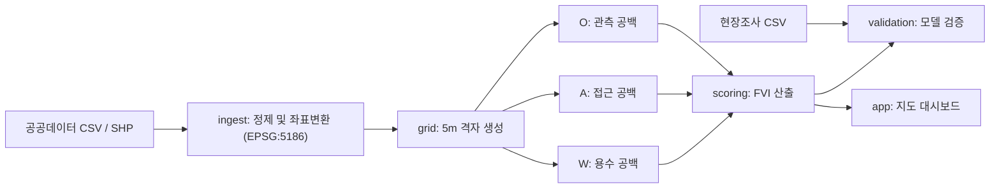

# 🔥 safe-sound

> CCTV 사각지대와 골목 구조 때문에 생기는 **화재 대응 공백**을 격자 단위로 정량화하는 공간 데이터 프로젝트

| 항목 | 내용 |
|---|---|
| 파일럿 지역 | 서울 노원구 공릉동 일대 |
| 현재 단계 | Phase 1: 공공데이터 수집 및 현장조사 정리 |
| 주요 스택 | Python 3.11, GeoPandas, Shapely 2.x, OSMnx, (PostGIS) |

---

## 1. 문제 정의

### 1.1 골든타임 KPI는 "신고 이후"만 측정합니다

- 소방청이 정의하는 화재 골든타임은 **신고 접수부터 현장 도착까지 7분**입니다.
  - 근거는 발화 후 약 8분이면 최성기에 도달한다는 이론입니다.
- 2026년 상반기 전국 7분 도착률은 **70.3%**입니다. (전년 68.3%)

여기에 구조적인 빈틈이 있습니다. **최성기까지의 시계는 발화 시점부터** 흐르지만, **KPI의 시계는 신고 시점부터** 흐릅니다.

```text
발화 ──[T_detect]──▶ 발견·신고 ──[T_dispatch + T_travel]──▶ 현장 도착 ──[T_access]──▶ 화점 접근 ──[T_water]──▶ 방수
      ▲ KPI 밖                    ▲ 7분 도착률 측정 구간                  ▲ KPI 밖                  ▲ KPI 밖
```

| 구간 | 의미 | 공간적 원인 |
|---|---|---|
| `T_detect` | 발화부터 발견·신고까지 | **CCTV 사각지대**, 무인·야간 시간대 |
| `T_access` | 차량 정차 지점부터 화점까지 | 좁은 골목, 불법주정차, 적치물 |
| `T_water` | 수원 확보까지 | 소방용수시설·비상소화장치와의 거리 |

**핵심 가설:** `T_detect`, `T_access`, `T_water`가 긴 공간에서는 7분 안에 도착해도 이미 늦을 수 있습니다. 이 세 구간은 공식 도착률 지표에 드러나지 않으며, 도시 구조에 따라 **특정 위치에 집중**됩니다.

### 1.2 규모 (서울 기준)

| 지표 | 수치 | 출처 |
|---|---|---|
| 소방차 진입곤란·불가 지역 | 316개소 (진입 불가 96개소) | 서울시의회, 2026.11 |
| 소방용수시설 | 60,192곳 | 서울시, 2026.11 |
| 비상소화장치 | 2,579곳 | 서울시, 2026.11 |
| 최근 5년 화재 (2021~2025) | 27,777건 | 서울시, 2026.11 |

---

## 2. 목표와 비목표

### Goals
- **G1.** 격자(5m × 5m) 단위로 화재 대응 취약 지수(FVI, Fire Vulnerability Index)를 산출합니다.
- **G2.** 현장조사 데이터로 모델을 검증하고, 오차를 정량적으로 보고합니다.
- **G3.** 개선 우선순위를 제안합니다. (비상소화장치·CCTV 추가 설치 후보 위치)

### Non-Goals
- 영상 분석을 통한 실시간 화재 감지는 하지 않습니다.
- 치안(범죄) 분석은 이번 범위에서 제외하며, 향후 확장 과제로 둡니다.
- 공식 소방 데이터나 소방 당국의 판단을 대체하지 않습니다. 의사결정을 보조하는 도구입니다.

---

## 3. 접근 방법

### 3.1 지수 정의

```text
FVI(c) = w_o · O(c) + w_a · A(c) + w_w · W(c)        (0 ≤ FVI ≤ 1, Σw = 1)

O(c)  관측 공백 = 1 − (셀 c가 CCTV 가시영역에 포함되는 비율)
A(c)  접근 공백 = norm( 소방차 진입 가능 도로 끝 → 셀 c 까지의 보행망 거리 )
W(c)  용수 공백 = norm( 셀 c → 가장 가까운 사용 가능 소방용수시설·비상소화장치 거리 )
```

- `norm`: 임계값 기반 cap 정규화입니다. (예: 거리가 임계값 이상이면 1)
- 가중치 초기값은 휴리스틱으로 정하고, 소방 자문과 민감도 분석으로 조정합니다.

### 3.2 레이어별 계산

| 레이어 | 입력 | 방법 |
|---|---|---|
| **O** 관측 | CCTV 위치·촬영방면, 건물 폴리곤 | 광선 투사(ray casting)로 가시영역 계산 → 격자 래스터화 |
| **A** 접근 | 도로 중심선 + 도로폭 | 폭이 임계값 이상인 도로만 "차량망"으로 분리 → 차량망 종단점에서 보행망 최단거리 |
| **W** 용수 | 소방용수시설(`사용가능여부 = Y`), 비상소화장치 | 보행망 최단거리 (직선거리 사용 안 함) |

> **왜 직선거리가 아닌가:** 소방호스와 대원은 건물을 관통할 수 없습니다. 직선거리 50m라도 골목을 돌아가면 120m일 수 있으므로, 반드시 보행 네트워크 거리를 사용합니다.

### 3.3 검증

| 대상 | 방법 | 지표 |
|---|---|---|
| O 레이어 | 현장조사 셀 라벨(보임/안 보임) vs 모델 | Precision, Recall, IoU |
| A 레이어 | 현장 측정 골목 유효폭 vs 데이터상 도로폭 | MAE (m) |
| FVI 전체 | 가중치 ±20% 변화 시 상위 10% 취약 셀의 순위 안정성 | Kendall τ |

### 3.4 성능 메모

- **Multi-source Dijkstra:** 모든 소방용수시설을 출발점으로 묶어 한 번만 실행하면, 전체 노드까지의 최단거리를 O((V + E) log V)에 구할 수 있습니다. 셀마다 따로 탐색하는 방식보다 훨씬 빠릅니다.
- **STRtree 공간 인덱스:** 광선과 건물의 교차 검사를 bbox 후보로만 제한합니다.
- **좌표계:** 원본은 WGS84(위경도)이므로, 미터 단위 계산 전에 EPSG:5186으로 변환합니다.

---

## 4. 데이터 소스

| 데이터 | 제공처 | 주요 필드 | 용도 | 상태 |
|---|---|---|---|---|
| CCTV정보 | 행정안전부 (localdata.go.kr) | 위경도, 카메라대수, 화소, 촬영방면 | O | ✅ 확인 |
| 소방용수시설 현황 | 서울소방재난본부 (열린데이터광장 OA-21306) | 시설유형, 위경도, 사용가능여부, 보호틀유무, 설치연도 | W | ✅ 확인 |
| 비상소화장치 설치 현황 | 서울 열린데이터광장 | 위치 | W | 🔍 필드 확인 필요 |
| 소방차 진입곤란·불가 지역 | 서울소방재난본부 | 위치 목록 | A 검증 | ⚠️ 공개 여부 확인, 필요 시 정보공개청구 |
| 건물 폴리곤 | 국토교통부 GIS건물통합정보 또는 OSM | 외곽선, 구조, 사용승인일 | O (가림) | 🔍 확인 필요 |
| 도로 중심선·폭 | 도로명주소 전자지도 또는 OSM | 도로폭 | A | 🔍 폭 속성 정확도 확인 필요 |
| 현장조사 | 팀 자체 수집 | [5장 스키마](#52-데이터-스키마) | 검증 | 🟡 진행 중 |

**데이터 한계**
- CCTV의 `촬영방면` 필드는 최대 10자의 문자열이라, 정확한 화각이나 가림 요소를 알 수 없습니다. → 화각·반경은 가정값으로 두고 현장조사로 보정합니다.
- 데이터상 도로폭은 **유효폭**(불법주정차·적치물 반영)과 다릅니다. → 현장조사로 보정합니다.

---

## 5. 현장조사: 공릉 일대

### 5.1 프로토콜
- 같은 구간을 **주간 1회, 야간 1회** 조사합니다. (주정차 패턴과 조도가 다르기 때문)
- 지점마다 GPS 좌표와 정확도(m)를 함께 기록합니다.
- 사진에는 **행인 얼굴과 주택 내부가 찍히지 않게** 합니다.

### 5.2 데이터 스키마

| 필드 | 타입 | 예시 | 용도 |
|---|---|---|---|
| `point_id` | TEXT | `GN-0042` | 식별자 |
| `lat`, `lon` | REAL | 37.62, 127.07 | 위치 |
| `gps_acc_m` | REAL | 5.0 | 위치 신뢰도 |
| `surveyed_at` | TIMESTAMP | 2026-11-12 22:30 | 주간/야간 구분 |
| `cctv_present` | BOOL | `true` | 공공데이터와 대조 |
| `cctv_heading` | ENUM (8방위) | `NE` | O 레이어 화각 보정 |
| `cctv_type` | ENUM | `고정` / `회전` | O 레이어 화각 보정 |
| `obstruction` | ENUM | `없음` / `나무` / `간판` / `주차차량` | 가림 요소 |
| `alley_width_m` | REAL | 2.5 | A 레이어 유효폭 |
| `illegal_parking` | ENUM | `없음` / `간헐` / `상시` | A 레이어 유효폭 감소 |
| `hydrant_visible` | ENUM | `없음` / `있음` / `가려짐` | W 레이어 검증 |
| `ext_device` | ENUM | `없음` / `비상소화장치` / `보이는소화기` | W 레이어 검증 |
| `combustibles` | ENUM | `없음` / `소량` / `다량` | 가연물 적치 (확장 지표) |
| `photo_url` | TEXT | — | 근거 자료 |
| `notes` | TEXT | — | 자유 기록 |

---

## 6. 아키텍처



---

## 7. 디렉토리 구조

```text
firegap/
├── config/
│   └── params.yaml          # 격자 크기, 화각 가정값, 가중치
├── data/
│   ├── raw/                 # 원본 (git 미포함)
│   ├── interim/
│   └── processed/
├── field_survey/
│   ├── schema.md
│   └── gongneung/           # 현장조사 원본 CSV + 사진 메타
├── src/
│   ├── ingest/              # 공공데이터 수집·정제
│   ├── geo/                 # 좌표 변환, 격자 생성
│   ├── visibility/          # O: CCTV 가시영역 (ray casting)
│   ├── access/              # A: 차량망 분리, 보행망 거리
│   ├── water/               # W: 소방용수 거리
│   ├── scoring/             # FVI 산출
│   └── validation/          # 현장조사 대비 평가
├── notebooks/               # 탐색적 분석
├── app/                     # 지도 시각화
├── tests/
├── requirements.txt
└── README.md
```

---

## 8. 시작하기

> ⚠️ 아래 명령어는 **구현 예정** 인터페이스입니다.

```bash
git clone https://github.com/<org>/firegap.git
cd firegap
python -m venv .venv && source .venv/bin/activate
pip install -r requirements.txt

python -m src.ingest.run   --region gongneung
python -m src.scoring.run  --region gongneung
python -m src.validation.run --region gongneung
```

### 설정 예시: `config/params.yaml`

```yaml
grid_size_m: 5
crs: "EPSG:5186"

camera:                      # 촬영방면 데이터 부족 → 가정값, 현장조사로 보정
  default_fov_deg: 90
  default_radius_m: 30
  n_rays: 90

access:
  min_truck_road_width_m: 3.0   # 가정값, 소방 자문으로 확정 필요
  cap_distance_m: 150

water:
  cap_distance_m: 150

weights:                     # Σ = 1, 민감도 분석 대상
  observation: 0.40
  access: 0.35
  water: 0.25
```

---

## 9. 로드맵

- [x] **Phase 0** — 문제 정의, 데이터 인벤토리
- [ ] **Phase 1** — 공릉 일대 공공데이터 수집, 현장조사 데이터 정리
- [ ] **Phase 2** — O 레이어: CCTV 가시영역 모델 및 현장 검증
- [ ] **Phase 3** — A·W 레이어 구현, FVI 산출, 민감도 분석
- [ ] **Phase 4** — 지도 대시보드, 관할 소방서 피드백 수렴
- [ ] **Phase 5** — 최적 배치: 최대 커버리지 입지 문제(MCLP)로 비상소화장치·CCTV 추가 설치 우선순위 도출

---

## 10. 한계와 윤리

| 이슈 | 대응 |
|---|---|
| **사각지대 지도의 악용 가능성** | 공개 산출물은 50m 이상 격자로 집계하고, 고해상도 원본은 비공개로 관리합니다. |
| 가정값 의존 | 화각·반경·도로폭 임계값이 가정이므로, 결과에 불확실성 범위를 함께 표기합니다. |
| 공식 판단 대체 불가 | 모든 산출물에 "의사결정 보조용"임을 명시합니다. |
| 현장조사 개인정보 | 얼굴·주택 내부 촬영 금지, 원본 사진은 비공개 저장소에 보관합니다. |
| 데이터 시차 | 데이터별 기준일자를 산출물 메타데이터에 기록합니다. |

---

## 11. 참고 자료

### 통계·정책
- 소방청 골든타임 정의 (신고 접수 → 현장 도착 7분, 최성기 8분 이론) — [뉴시스, 2023.03](https://mobile.newsis.com/view/NISX20230310_0002222414)
- 2026년 상반기 7분 도착률 70.3% — [뉴스핌, 2026.08](https://www.newspim.com/news/view/20260805000671)
- 서울 소방차 진입곤란·불가 지역 316개소 — [서울신문, 2026.11.06](https://go.seoul.co.kr/news/newsView.php?id=20261106500169)
- 서울 소방용수시설·비상소화장치 현황, 최근 5년 화재 건수 — [서울신문, 2026.11.02](https://go.seoul.co.kr/news/newsView.php?id=20261102019005)

### 데이터
- [행정안전부 CCTV정보 (공공데이터포털)](https://www.data.go.kr/data/15013094/standard.do)
- [서울시 소방용수시설 현황 (서울 열린데이터광장)](https://data.seoul.go.kr/dataList/OA-21306/S/1/datasetView.do)

### 데이터 이용 조건
- 서울소방재난본부 제공 데이터는 **공공누리 제1유형(출처표시)** 조건에 따라 이용합니다.
- 그 밖의 데이터는 각 제공처의 이용 조건을 따릅니다.

---

## 팀

| 역할 | 이름 | 담당 |
|---|---|---|
| Data / Modeling | `@github-id` | 공간 분석 파이프라인, FVI 설계 |
| Field / Domain | `@github-id` | 현장조사, 도메인 검증 |

## License

- 코드: TBD (MIT 제안)
- 데이터: 각 제공처 이용 조건을 따릅니다.
